<h1 align="center">Hello, I'm Tanish Gupta.</h1>

  

  <strong>C# / .NET Developer · React &amp; TypeScript</strong> 
  Final-year B.Sc. Computer Science student · Mumbai, India

  <a href="https://www.linkedin.com/in/tanish-gupta09/">LinkedIn</a>
  &nbsp; · &nbsp;
  <a href="mailto:tanish.s.gupta09@gmail.com">Email</a>
  &nbsp; · &nbsp;
  <a href="https://github.com/Tanish15-gif?tab=repositories">Explore my work</a>

---

## Behind the Code

I'm Tanish, a final-year **B.Sc. Computer Science student** in Mumbai, focused on building web applications with **C# and ASP.NET Core**.

I've built several applications using **.NET technologies** for the backend and **React with TypeScript** for the frontend, working with APIs, authentication, and SQL Server.

I learn by building, asking questions, and improving the code I write. My interests include backend development, clean application structure, and thoughtful web interfaces. I'm also expanding into **Python and AI/ML**, exploring how data and intelligent systems can solve practical problems.

I'm passionate about solving **data structures and algorithms (DSA)** problems and strengthening my problem-solving skills.

[Explore my repositories](https://github.com/Tanish15-gif?tab=repositories) for project details, source code, and documentation.

## Tech Stack

  <picture>
    <source media="(prefers-color-scheme: light)" srcset="https://skillicons.dev/icons?i=cs,dotnet,react,ts,js,html,css,git,github,postman&amp;theme=light&amp;perline=5" />
    
  </picture>

| Area           | Technologies                                                      |
| -------------- | ----------------------------------------------------------------- |
| Backend        | C#, ASP.NET Core Web API, Entity Framework Core, ADO.NET, SignalR |
| Frontend       | React, TypeScript, JavaScript, HTML, CSS                          |
| Data           | SQL Server                                                        |
| AI integration | Microsoft Semantic Kernel, Groq                                   |
| Workflow       | Git, GitHub, Postman                                              |

## Next in the Toolbox

Currently learning and exploring:

<table>
  <tr>
    <td align="center" width="64"></td>
    <td><strong>Python</strong> → Writing scripts, working with data, and building a foundation for AI/ML.</td>
  </tr>
  <tr>
    <td align="center"></td>
    <td><strong>Docker</strong> → Packaging applications into containers for consistent development and deployment.</td>
  </tr>
  <tr>
    <td align="center"></td>
    <td><strong>Kubernetes</strong> → Understanding how containers are deployed, managed, and scaled.</td>
  </tr>
  <tr>
    <td align="center"></td>
    <td><strong>AI / ML</strong> → Exploring data preparation, model training, and evaluating predictions.</td>
  </tr>
</table>

## Let's Connect

Have a project idea, a question about my code, or an opportunity to learn and contribute? I'd be happy to connect.

- **LinkedIn:** [Tanish Gupta](https://www.linkedin.com/in/tanish-gupta09/)
- **Email:** [tanish.s.gupta09@gmail.com](mailto:tanish.s.gupta09@gmail.com)

<!-- Custom laptop animation and AI/ML symbol are in ./assets/. -->
<!-- Technology icons: https://github.com/tandpfun/skill-icons -->
